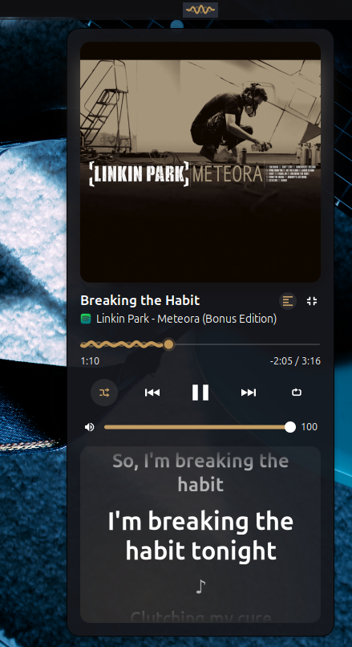
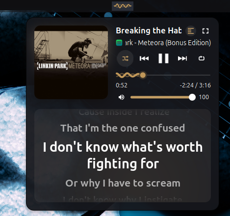
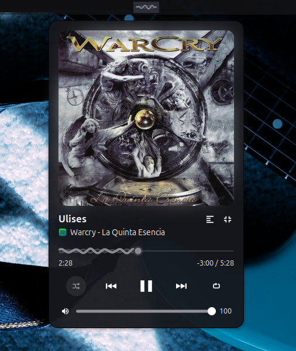
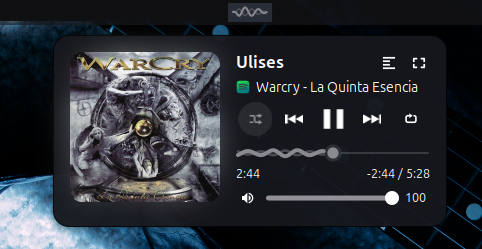

<h1 align="center">Encore - Now Playing</h1>

<p align="center">
  A now-playing card for GNOME Shell, with a living visualizer in the top bar,<br>
  synced lyrics and colors taken from the album art.
</p>

<p align="center">
  
  &nbsp;&nbsp;
  
</p>

Encore works with any player that speaks [MPRIS](https://specifications.freedesktop.org/mpris-spec/latest/),
the standard Linux interface for media players: Spotify, Rhythmbox, Lollypop, Elisa, Amberol, VLC,
mpv (with mpv-mpris), web browsers playing audio or video, and many more.

## Highlights

- **A visualizer in the top bar** that never loops the same way twice, in four styles: Wave, Bars,
  Orbit and an old acetate Disc with a tonearm.
- **A card in two sizes**, compact or large, with artwork, a smooth seek bar, shuffle, repeat and
  volume.
- **Synced lyrics** that unfold under the card and follow the song, from the player, from your own
  `.lrc` files and tags, or (if you turn it on) from the internet. They can also run in the top bar.
- **Colors from the album art** for the visualizer, the sliders and a soft glow behind the cover.
- **Several players at once**, with a sidebar to switch between them.
- **Light and dark**, following GNOME's style, and respecting "reduce animation".
- **Private by default**: nothing goes online for lyrics unless you ask for it.
- English and Spanish.

## Two sizes, colors from the cover

<p align="center">
  
  &nbsp;&nbsp;
  
</p>

Switch between the large and compact card with the button in its corner. The visualizer in the top
bar, the seek bar, the volume and the active buttons take their colors from the artwork: gold for
the album above, silver for this one.

## Installation

### From source

```bash
git clone https://github.com/juanfer-rg/encore-now-playing.git
cd encore-now-playing
make install
```

`make install` compiles the settings schema and the translations, and links the folder into
`~/.local/share/gnome-shell/extensions/`. On Wayland, log out and back in, then:

```bash
make enable
```

Open the preferences with:

```bash
gnome-extensions prefs encore-now-playing@juanfer-rg.github.io
```

### Requirements

- GNOME Shell 48, 49 or 50
- `glib-compile-schemas` and `msgfmt` (gettext) to build from source

## Features

<details>
<summary><b>Top bar</b></summary>

- **Visualizer**, always shown. It moves while *any* player is playing, not only the one shown in
  the card, and settles when everything is paused. Four styles:
  - **Wave**: Encore's ribbon, two thin strands that twist around each other
  - **Bars**: rounded bars that rise and fall smoothly
  - **Orbit**: two dots with trails, tracing figures that morph into each other
  - **Disc**: an old acetate record with sweeping sheen and a two-tone label, and a tonearm that
    rests on it while playing and lifts when paused; it pulses with the beat and is now and then
    scratched backwards

  None of them repeats the same loop: speed, height, the beats, the orbit's figure and the disc's
  spin change at random, with smooth transitions. It is white, or, with album art colors on, a blend
  of up to three colors of the artwork that is playing. The visualizers are animations, not an
  analysis of the actual sound.
- **Optional extras**, all off by default:
  - album art or the player's icon
  - the title and artist, which scroll when they do not fit
  - previous/play/next buttons
- **Lyrics in the top bar**: choose *Lyrics* as the top bar text to show the current line of the
  lyrics; it follows the song even while the card is closed.
- **Mouse**: click to open the card, middle-click to play or pause, and scroll to change the volume
  or the track (configurable).
- **Placement**: left, center or right section, at any position among the visible items.

</details>

<details>
<summary><b>Player card</b></summary>

- **Two styles**, switched with the button in the card's corner (also in the preferences):
  - **Compact**: artwork on the left, controls on the right
  - **Large**: big artwork on top, everything else below it
- **Contents**:
  - artwork, with a fixed size in each style (150 px compact, 300 px large) whatever the player or
    the shape of its image; wide video thumbnails are cropped to a square
  - title and "artist - album [year]", with the player's icon in front; both scroll when they do not
    fit
  - shuffle, previous, play/pause, next and repeat
  - a ribbon seek bar whose handle glides smoothly, with the elapsed time on the left and
    "remaining / total" on the right
  - the volume across the bottom, with the percentage; click the speaker to mute or unmute
- **Several players**: the one playing most recently is shown. With two or more, a bar on the left
  of the card shows each player's icon, with a dot under the ones playing; click one to show it.
  Other players can optionally pause when one starts.
- **Click the artwork** to bring the player's window to the front.

</details>

<details>
<summary><b>Lyrics</b></summary>

- They unfold below the card with the lyrics button, next to the style button.
- They scroll by themselves with the song, with no scrollbar:
  - the current line is centered, bigger and bright, its neighbors smaller and the rest faint
  - the top and bottom edges fade out
  - unsynced lyrics are spread over the track, so they move line by line too
  - scrolling by hand pauses the following for a moment, and clicking a synced line jumps there
- **Sources, in this order**:
  1. the player itself (`xesam:asText`)
  2. **for local files**, with no internet needed:
     - a `.lrc` file with the same name beside the track (`Song.flac` → `Song.lrc`)
     - lyrics embedded in the file: MP3 ID3 tags (USLT and synced SYLT) and FLAC Vorbis comments
       (`LYRICS`, `UNSYNCEDLYRICS`, `SYNCEDLYRICS`). Only the tag area is read; covers and audio
       are skipped. Several ID3 tags in a row and v2.4 tags written with v2.3-style sizes
       (MusicMatch and others) are handled.
  3. **online, only if you turn it on** (off by default): [lrclib.net](https://lrclib.net) (exact
     match, then a search by closest duration) and [lyrics.ovh](https://lyrics.ovh), asked in
     parallel. Synced lyrics win.

  For local files, the player must report the file's location (`xesam:url`). Most local music
  players do; streaming apps and browsers do not.

</details>

<details>
<summary><b>Colors and style</b></summary>

- **Colors from album art** (on by default) never tints the card itself. Instead:
  - the visualizer blends up to three of the artwork's colors
  - the volume slider and the active buttons take its main color
  - a soft, blurred ambient glow appears behind the artwork, kept discreet and fainter still for
    light artwork
  - the lyrics get a very subtle backdrop of glows in the artwork's colors that drift slowly

  With the option off, a manual accent color is used and there is no glow.
- **Light and dark**: follows GNOME's style and switches live when you change it.
- **Animations** respect GNOME's "reduce animation" setting.

</details>

<details>
<summary><b>Other</b></summary>

- Blocklist for players you never want to see.
- Option to hide GNOME's own media player in the notification list.
- Translations: English and Spanish.

</details>

## Preferences

| Page | What you can change |
| --- | --- |
| **Top Bar** | Section and position, hide when nothing plays, visualizer style, icon, text (title, artist or lyrics), playback buttons, text width and scrolling, scroll-wheel action |
| **Card** | Compact or large style, width of the compact card, volume, shuffle/repeat and lyrics buttons, colors from album art, accent color |
| **Players** | Turn off players you want ignored |
| **Behavior** | Pause other players, click the artwork to show the player, hide GNOME's media player, online lyrics, album art cache size |

Options you have changed are marked with a dot. Each page ends with a *Restore defaults for this
page* button, which lists exactly what it will change (for example, "Order: 3 → 0") and asks for
confirmation first.

## Privacy

Encore talks to the network in only two cases:

- **Artwork**, when the player itself gives an `http(s)` address for it.
- **Lyrics**, only after you turn on online lookup. The artist, title, album and duration of the
  current track are then sent to lrclib.net and lyrics.ovh.

Local lyrics (`.lrc` files and tags) never leave your computer. Downloaded artwork is cached in
`~/.cache/encore-now-playing/art`, trimmed to the size set in the preferences (50 MB by default).

## Development

[docs/ARCHITECTURE.md](docs/ARCHITECTURE.md) explains how the code is organized and why.

| Command | What it does |
| --- | --- |
| `make install` | Compile schemas and translations, link the folder into the extensions directory |
| `make test` | Unit tests for the pure logic (colors, lyrics parsers, embedded tags) with plain `gjs` |
| `make logs` | Follow GNOME Shell's log |
| `make pot` | Regenerate the translation template and merge it into every `.po` file |
| `make pack` | Build `dist/<uuid>.shell-extension.zip` for extensions.gnome.org |
| `make lint` | Run ESLint (run `npm install` once first) |

### Test without a real player

`tests/mockPlayer.js` is a fake MPRIS player with three tracks. It supports seek, volume, shuffle
and repeat, and prints every call it receives.

```bash
gjs -m tests/mockPlayer.js [NAME] [OPTIONS]
```

| Option | Effect |
| --- | --- |
| `NAME` | Bus name suffix (default `EncoreTest`); run several with different names to test the player bar |
| `--lyrics` | Provide synced lyrics through `xesam:asText` |
| `--plain-lyrics` | Provide unsynced lyrics |
| `--art=PATH_OR_URL` | Artwork for the first track (`file://` or `http(s)://`) |
| `--desktop=APP_ID` | Pretend to be an installed app, to get its icon (e.g. `--desktop=vlc`) |
| `--file=FILE_URI` | Report a local file as the track, to test `.lrc` and embedded lyrics |

### Check embedded lyrics against a music folder

```bash
gjs -m tests/scanLyrics.js ~/Music 2000
```

It reads a sample of MP3 and FLAC files, compares a raw search for lyrics tags with what the reader
extracts, and lists the files where they disagree. Nothing is modified.

### Nested session

GNOME 49 and later replaced `--nested` with the development kit (install `mutter-dev-bin` or your
distribution's equivalent):

```bash
dbus-run-session gnome-shell --devkit --wayland
```

### Translations

Copy `po/es.po` to `po/<language>.po`, translate it, and run `make locale` (or `make install`).
After changing strings in the code, run `make pot` to update the template and every translation.

## License

Not chosen yet. extensions.gnome.org requires a GPL-compatible license; GPL-2.0-or-later (the
license of GNOME Shell itself) is the usual choice.
